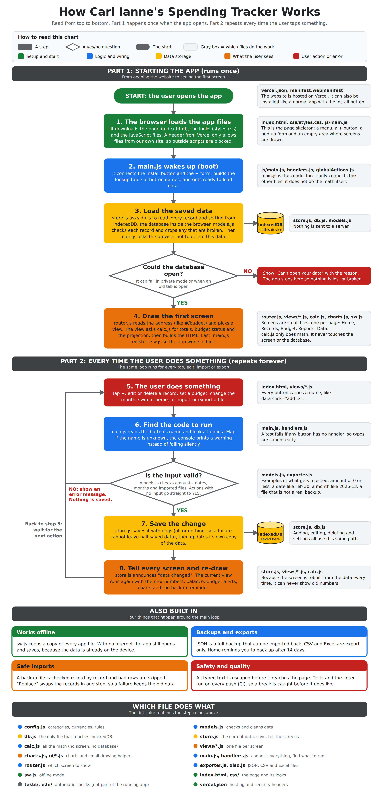

# Carl Ianne's Spending Tracker

A student allowance and spending tracker. It runs **100% in the browser**: no server, no account.
Your data is saved on your own device using **IndexedDB**, and the app works **offline** as a **PWA** (installable).

## Features
- Record money received (allowance) and money spent
- Money left (carries over between months), budget limit warnings, per-category limits
- Spending by category and by week, compare two months, projected balance, savings goal
- Dark mode (default, forest green) and light mode (Google-style colors)
- Backup/restore with **JSON** (import + export). **CSV** and **Excel (.xlsx)** are export-only
- Install button (Chrome, Edge, Android; on iPhone use Share, then Add to Home Screen)

## How the program works


The picture is `docs/flowchart.png`. A scalable copy is `docs/flowchart.svg` (it looks best with the DejaVu Sans font installed; use the PNG if text looks off).
To print it, use A3 paper or split it in two, because the text is small on a single A4 page.

## Folder structure
```
index.html            the page shell (menu, + button, pop-up form)
manifest.webmanifest  PWA info (name, icons, colors)
sw.js                 service worker: offline cache
vercel.json           Vercel settings (headers)
css/styles.css        every color and layout (theme = CSS variables)
js/
  main.js             START HERE: connects everything, handles clicks
  config.js           categories, currencies, defaults  (edit lists here)
  models.js           what a record looks like + validation
  db.js               IndexedDB (the ONLY file that touches the database)
  store.js            current data, save/delete, tells screens to re-draw
  calc.js             all the math (pure functions, easy to test)
  charts.js           donut + bar charts (no libraries)
  exporter.js         JSON / CSV / Excel export, JSON import checking
  xlsx.js             builds a real .xlsx file without libraries
  router.js           which screen to show from the URL (#/budget)
  handlers.js         builds the click/change/submit lookup tables (Maps)
  globalActions.js    actions that work on every screen (+ button, theme, install, month arrows)
  views/              ONE FILE PER SCREEN (dashboard, transactions, budget, reports, data)
  ui/                 small helpers: dom, icons, toast, theme, install, txRow, txDialog
tests/run.mjs         fast tests of the logic, security rules and colors:  npm test
e2e/                  real-browser tests (Playwright) + dev server:  npm run test:e2e
eslint.config.js      lint rules (code spell-checker):  npm run lint
.github/workflows/    CI: runs lint + tests + browser tests on every push
```

## Reading order for learning
`config.js` → `models.js` → `calc.js` → `db.js` → `store.js` → `views/dashboard.js` → `main.js`

## Rules that keep the code from breaking
1. **Only `db.js` talks to IndexedDB.** Screens never touch the database directly.
2. **`calc.js` has no screen or database code.** Same input always gives the same output.
3. **Every record passes through `buildTransaction()`** (typed or imported), so bad data never gets saved.
4. **User text is always wrapped in `esc()`** before going into HTML.
5. **Each screen is isolated.** If one screen crashes, `main.js` shows an error card and the rest still works.
6. **`render()` functions only read data.** They never change state or the database.
7. **Every month, number and date from an input box is validated** (`isValidMonth`, `buildTransaction`) **and escaped** before it reaches the page.
8. **Lookup tables are `Map`s**, never plain objects (a plain object already contains names like `constructor`).
9. **A mistyped `data-click="..."` is never silent**: the console warns, and a test fails if any button in the HTML has no handler (or a handler has no button).
10. **Colors must stay readable**: a test checks every text/background pair in both themes (WCAG AA, 4.5:1) and a browser test measures the real painted colors on every screen.
11. Run `npm run check` (lint + unit tests + browser tests) before every push. CI runs the same thing. It also enforces rules 2 and the offline file list:
   - `calc.js`, `models.js`, `config.js`, `xlsx.js` may not import UI/db/store or touch the browser
   - every file in `js/` and `css/` must be listed in `sw.js` (otherwise it is not cached offline)

## How to change things safely
| I want to... | Edit |
|---|---|
| Add a spending category or currency | `js/config.js` only |
| Change colors / dark or light theme | `css/styles.css` (top section) |
| Add a new screen | copy a small file in `js/views/`, then add one line in `js/views/index.js` and the file name in `sw.js` |
| Add a new field to records | `models.js` (validation), then the form in `ui/txDialog.js` |
| Change the database structure | `db.js`, and raise `DB_VERSION` in `config.js` |
| Release an update to users | change `CACHE_VERSION` in `sw.js` (it is `v2` now) |

## Run locally
Service workers need `http://localhost` (not opening the file directly). First time only:
```
npm install
npx playwright install chromium
```
Then:
```
npm start            # http://localhost:4173, with the same security headers as Vercel
npm run lint         # code spell-checker
npm test             # fast logic/security/color tests
npm run test:e2e     # real browser: desktop + phone, offline mode, install button, backups...
npm run check        # all three
```
After the first `npm install`, commit the generated `package-lock.json` and change `npm install` to `npm ci` in `.github/workflows/ci.yml`.

## Deploy: GitHub + Vercel
1. Create a new empty repo on GitHub.
2. In this folder:
   ```
   git init
   git add .
   git commit -m "Spending Tracker"
   git branch -M main
   git remote add origin https://github.com/YOUR-NAME/YOUR-REPO.git
   git push -u origin main
   ```
3. On vercel.com: **Add New → Project → Import** your repo.
4. Leave **Framework Preset = Other**, build command empty, output directory empty. Click **Deploy**.
5. Every `git push` to `main` redeploys automatically. To stop a broken version from going live, in GitHub go to
   Settings → Branches → add a rule for `main` that requires the **CI** check to pass.
   (`vercel.json` tells Vercel to skip `npm install`, because the site is plain static files.)
6. Open the Vercel URL and use the **Install app** button.

## Notes
- Data lives in each browser separately. Use **Export backup** to move data between devices.
- Clearing site data in the browser deletes your records. Export backups regularly.
- The app asks the browser to keep its data (`navigator.storage.persist()`), but the browser may refuse.
  The Home screen therefore reminds you to export a backup after 14 days (`BACKUP_REMIND_DAYS` in `config.js`).
- **Security header (CSP):** `vercel.json` only allows scripts and files from the app's own domain.
  If you ever add a CDN script, Google Font or inline `<script>`, the browser will block it until you update the
  `Content-Security-Policy` line in `vercel.json` (and `npm test` will remind you of the rule).
- **Changing the database structure:** raise `DB_VERSION`. Users with an old tab still open will see
  "close other tabs, then reload" instead of a frozen app.
- Firefox desktop has no month picker; type the month as `2026-10`.
